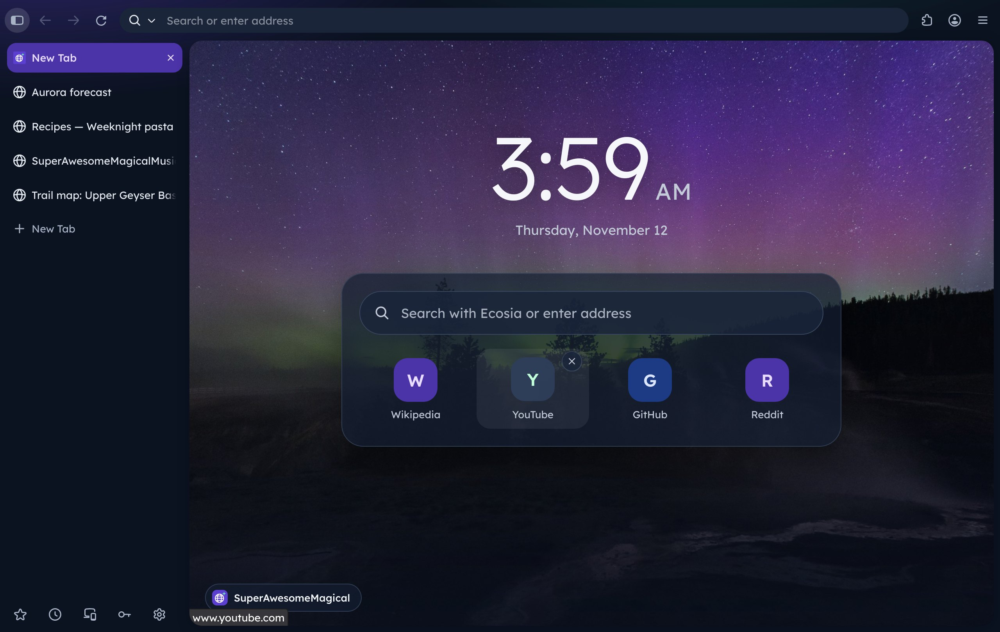
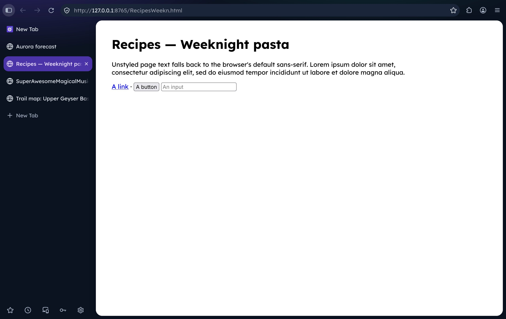
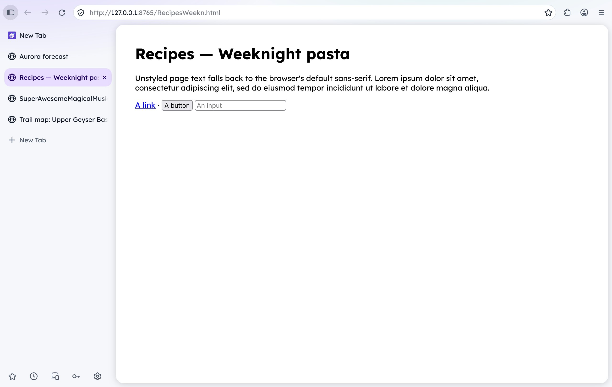
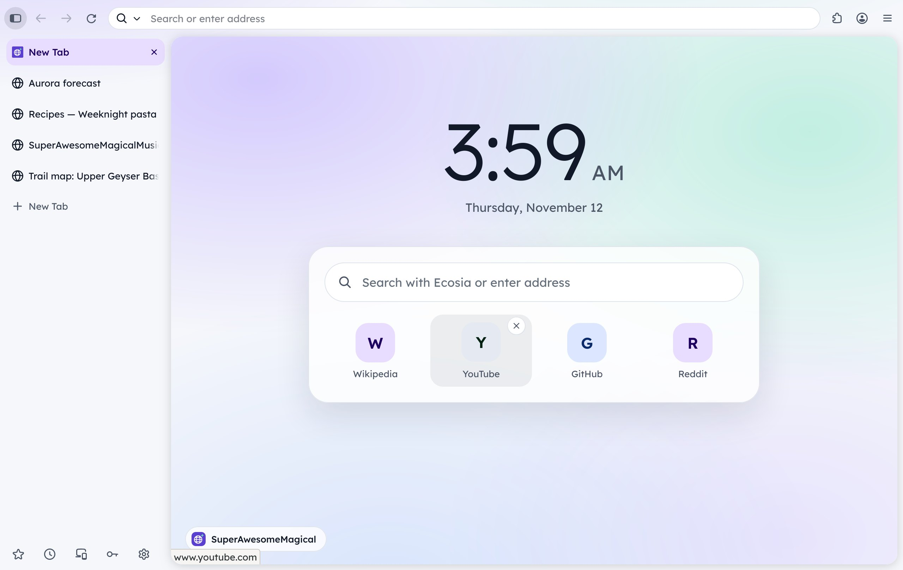
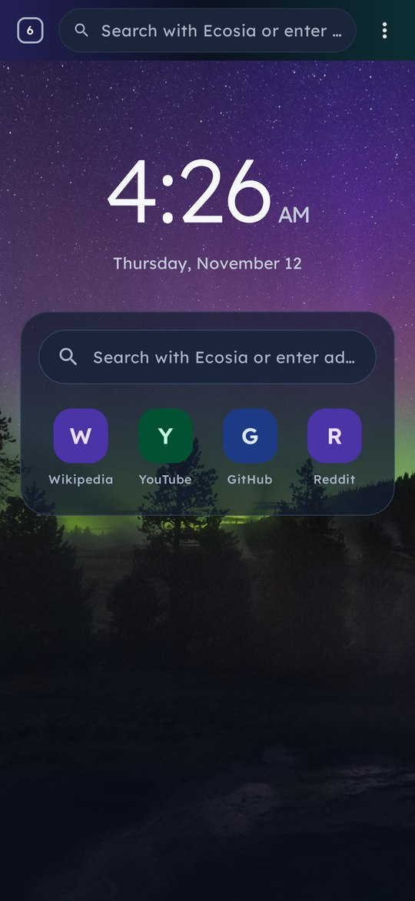
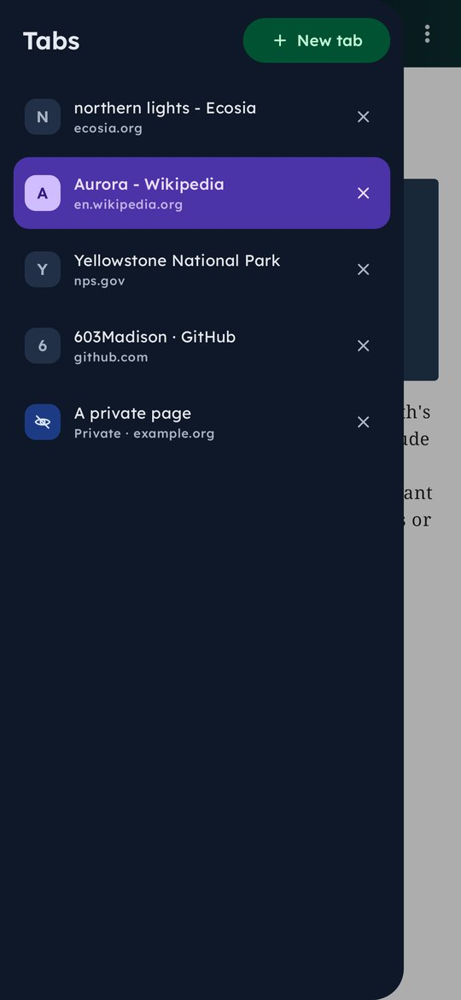
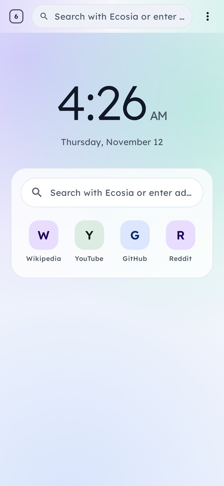
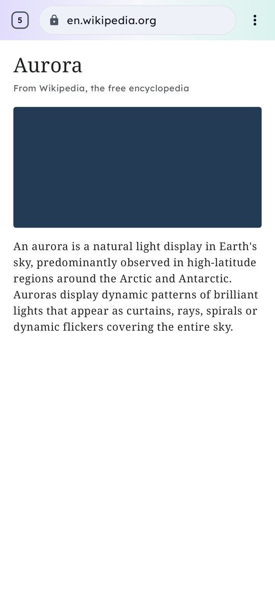

# SuperAwesomeMagical Browser

Firefox in the SuperAwesomeMagical family's look: Lexend everywhere, the aurora's purple and green
over cool slate, soft rounded cards, and your tabs down the left side. For Linux (Fedora- and
Ubuntu-based) and Android.



- **Tabs down the left.** Firefox's own vertical tabs, on from the start, with the page as a
  rounded card beside them.
- **Lexend everywhere.** The interface, Firefox's own pages (Settings, Add-ons and themes...), the
  start page, and web pages that don't choose a font. Lexend comes with the browser.
- **The family's colours.** Slate (`#0B1220` dark, `#F5F7FB` light) with the aurora's purple and
  green, light or dark as the system is. Settings and Firefox's other pages match.
- **A start page like the sign-in screen.** A big Lexend clock, search and your most visited sites
  over the northern lights (soft purple and green glows in light mode). Hover a site for × to
  remove it.
- **Ecosia** is the search engine (change it in Settings › Search).
- **Quiet.** No telemetry, studies, sponsored shortcuts or stories. Global Privacy Control is on.
- **Its own profile**, so it never mixes with a separately installed Firefox.

| | |
|---|---|
|  |  |
|  | |

## Installing on Linux

Download the package for your system from the latest
[release](https://github.com/603Madison/SuperAwesomeMagicalBrowser/releases/latest):

**Fedora** and others with dnf: `superawesomemagicalbrowser-<version>.x86_64.rpm`

```bash
sudo dnf install ./superawesomemagicalbrowser-*.x86_64.rpm
```

On SuperAwesomeMagicalLinux and other image-based Fedora (Silverblue, Bazzite...), layer it:

```bash
rpm-ostree install ./superawesomemagicalbrowser-*.x86_64.rpm
```

**Ubuntu** (24.04 and later), Debian 13, Mint, Pop!_OS: `superawesomemagicalbrowser_<version>_amd64.deb`

```bash
sudo apt install ./superawesomemagicalbrowser_*_amd64.deb
```

**Anything else**: the `.tar.xz` holds the whole browser in one folder; run
`superawesomemagicalbrowser` in it.

To make it your default browser, use *Make default* in Settings, or:

```bash
xdg-settings set default-web-browser io.github._603madison.SuperAwesomeMagicalBrowser.desktop
```

**Updates.** A new release follows every Firefox release (CI checks Mozilla every six hours and
builds, tests and publishes on its own), so install the newest package when one comes out. The
browser doesn't update itself: Firefox's own updater is off, as the package manages the files.

**Your data** lives in `~/.local/share/superawesomemagicalbrowser`. Firefox's Settings › Import
brings bookmarks, history and passwords over from Firefox or another browser.

## Android

The same browser for phones and tablets, on GeckoView (Firefox's engine for Android, the same
Firefox version as the Linux release). Install `SuperAwesomeMagicalBrowser-<version>-android-arm64-v8a.apk`
from the release (the `x86_64` one is for the emulator and Chromebooks).

- **Tabs on the left**: the tabs button at the left of the address bar opens them as a drawer
  from the left; on a tablet they stay down the left side.
- The **start page** with the big clock, Ecosia search and your most visited sites (hold one to
  remove it), over the northern lights in dark mode.
- Lexend and the family's colours throughout, light or dark with the phone.
- **Private tabs**, Firefox's tracking protection with Total Cookie Protection, Global Privacy
  Control, downloads to the Downloads folder, and it can be the phone's default browser.

| | | | |
|---|---|---|---|
|  |  |  |  |

## How it's made

It is **Mozilla's own Firefox**, downloaded from Mozilla and checked against Mozilla's signed
checksums, with **none of its files changed**. Everything ours is added beside them
(`desktop/layer`):

- `defaults/pref/superawesomemagical.js` and `superawesomemagical.cfg`: Firefox's
  [AutoConfig](https://support.mozilla.org/kb/customizing-firefox-using-autoconfig), which starts
  `superawesomemagical/modules/Startup.sys.mjs`. That sets our default preferences
  (`Prefs.sys.mjs`: vertical tabs, Lexend, quiet defaults; all changeable in Settings), adds the
  look to each window and registers the start page.
- `superawesomemagical/styles`: the look. `theme.css` sets Firefox's design tokens (the variables
  its interface is drawn with) to the family's colours and Lexend; `browser.css` lays out the
  window (one slate surface with the page as a card); `about.css` is for Firefox's own pages.
- `superawesomemagical/start`: the start page.
- `distribution/policies.json`: Firefox's
  [enterprise policies](https://mozilla.github.io/policy-templates/) for what preferences can't
  do: no telemetry or studies, no updater, Ecosia as the default search engine (set once; you can
  change it). Because a policy file is there, Settings says *"Your browser is being managed by
  your organization"*: the organization is this package, and nothing else manages it.
- `fonts/Lexend[wght].ttf`: Firefox makes fonts in its own `fonts` folder available to the
  interface and to pages.

Picking another theme in Add-ons and themes switches the SuperAwesomeMagical look off, so that
theme shows as its author meant. Firefox's own new tab page is one preference away
(`superawesomemagical.startpage.enabled` in about:config).

## Building

On Linux with `curl`, `gpg`, `xz` and `tar` (plus `dpkg-deb` for the .deb and `rpmbuild` for the
.rpm):

```bash
desktop/build.sh            # the browser folder and its .tar.xz, in desktop/out
desktop/build.sh all        # ... and the .deb and the .rpm
python3 desktop/check.py    # start it and check everything works (needs Xvfb if headless)
```

`desktop/release.env` pins the Firefox version (and the matching GeckoView), our release
number, and Lexend.

The Android app is a Gradle project in `android/` (Kotlin and Jetpack Compose on GeckoView):

```bash
cd android && ./gradlew testDebugUnitTest assembleRelease
```
`tools/icons.py` draws the icon. CI (`.github/workflows/linux.yml`) builds and checks every
change, tests the installed packages on Ubuntu 24.04, Debian 13 and Fedora, and publishes
releases; `.github/workflows/android.yml` tests the app and adds the signed APK to each release.

## Licence

GPL-3.0, like the rest of the family, for our files. Firefox is Mozilla's, under the MPL 2.0;
"Firefox" is Mozilla's trademark and this is not a Mozilla product. Lexend is under the SIL Open
Font Licence. The start page photo, *Aurora borealis, Upper Geyser Basin* by NPS / Neal Herbert,
is in the public domain (see `desktop/layer/superawesomemagical/start/CREDITS.md`).
