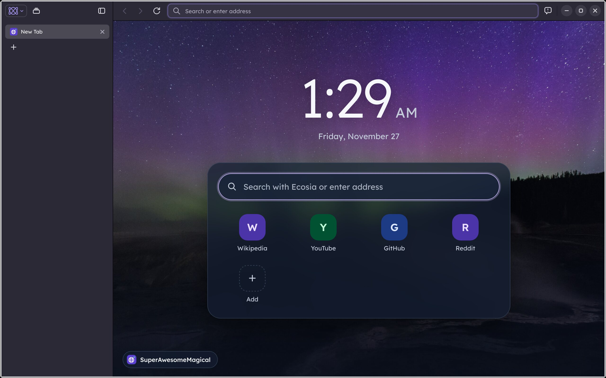
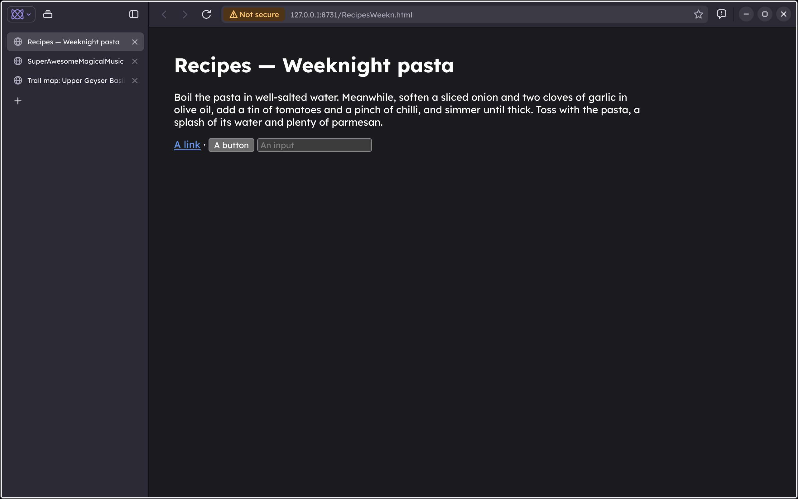
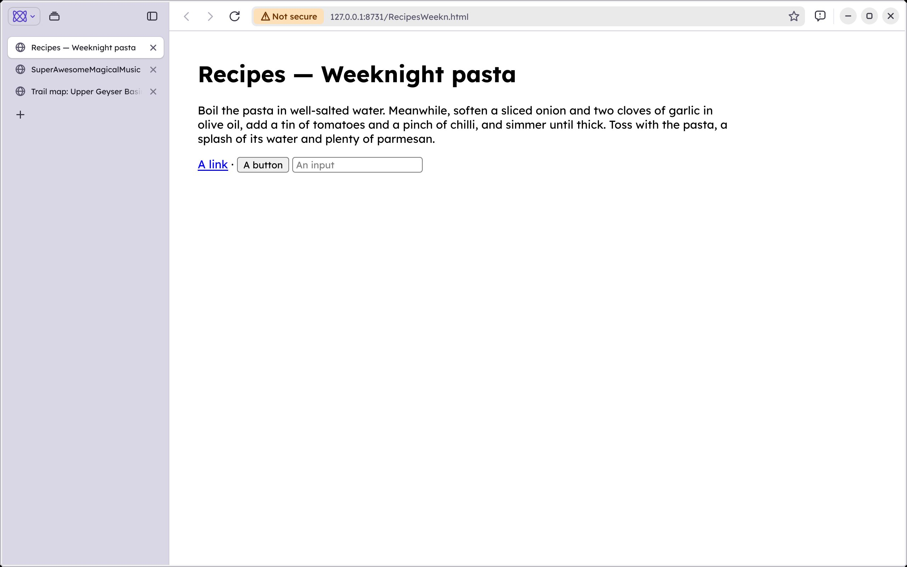
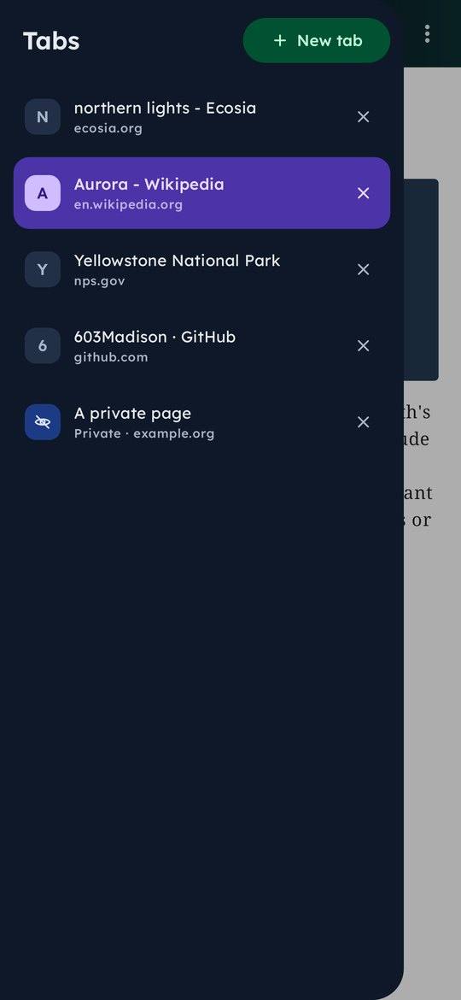

# SuperAwesomeMagical Browser

[Ladybird](https://ladybird.org), the independent web browser, set up the SuperAwesomeMagical
family's way: your tabs down the left side, Lexend everywhere, Ecosia for searches, and a start
page like the SuperAwesomeMagicalLinux sign-in screen. For Linux (Fedora- and Ubuntu-based), and
an Android app in the same look.



- **Tabs down the left.** Ladybird's own vertical tabs, on from the start.
- **Lexend everywhere.** The interface, Ladybird's own pages, the start page, and web pages that
  don't choose a font. Lexend comes with the browser.
- **The family's colours.** Ladybird's Lavender colour theme, the nearest to the aurora's purple,
  light or dark with the system.
- **A start page like the sign-in screen.** A big Lexend clock, an Ecosia search box and your
  shortcuts over the northern lights (soft purple and green glows in light mode). *Add* puts a
  site there; hover one for × to take it off.
- **Ecosia** is the search engine (change it in Settings).
- **Quiet.** Ads and trackers blocked, Global Privacy Control on. Ladybird has no telemetry.
- **Its own profile**, so it never mixes with a separately installed Ladybird.
- **Your bookmarks come along** from the Firefox-based versions on its first start.

| | |
|---|---|
|  |  |
|  | |

Ladybird is in alpha: some sites don't work yet, it crashes now and then, and its makers make no
promises about its security yet.

## Installing on Linux

The browser itself comes from Ladybird's own repository, which keeps it up to date, so add that
first. Then install this package from the latest
[release](https://github.com/603Madison/SuperAwesomeMagicalBrowser/releases/latest); it brings
Ladybird with it.

**Fedora** and others with dnf: `superawesomemagicalbrowser-<version>.x86_64.rpm`

```bash
sudo curl -fsSL -o /etc/yum.repos.d/ladybird.repo https://rpm.ladybird.org/ladybird.repo
```

```bash
sudo dnf install ./superawesomemagicalbrowser-*.x86_64.rpm
```

SuperAwesomeMagicalLinux has it already.

**Ubuntu** 24.04: `superawesomemagicalbrowser_<version>_all.deb` (on 26.04 and newer, use
`ladybird-resolute.sources` in place of `ladybird-noble.sources`)

```bash
sudo install -d /etc/apt/keyrings
sudo curl -fsSL -o /etc/apt/keyrings/ladybird.asc https://apt.ladybird.org/ladybird.asc
sudo curl -fsSL -o /etc/apt/sources.list.d/ladybird.sources https://apt.ladybird.org/ladybird-noble.sources
```

```bash
sudo apt update && sudo apt install ./superawesomemagicalbrowser_*_all.deb
```

To make it your default browser:

```bash
xdg-settings set default-web-browser io.github._603madison.SuperAwesomeMagicalBrowser.desktop
```

**Updates.** Ladybird's updates come with your system's updates, from Ladybird's repository. A
new release here is only for changes to our part (the start page, the presets).

**Your data** lives in Ladybird's profile `superawesomemagical`
(`~/.config/Ladybird/Profiles/superawesomemagical`, and the matching folders in `~/.local/share`
and `~/.cache`). The Firefox-based versions' profile stays in
`~/.local/share/superawesomemagicalbrowser/profile`; its bookmarks are copied over once, and you
can delete it when you no longer need it.

## Android

Ladybird has no Android version yet, so the app for phones and tablets is on GeckoView (Firefox's
engine for Android), in the same look. Install `SuperAwesomeMagicalBrowser-<version>-android-arm64-v8a.apk`
from the newest `android-v…` [release](https://github.com/603Madison/SuperAwesomeMagicalBrowser/releases)
(the `x86_64` one is for the emulator and Chromebooks).

- **Tabs on the left**: the tabs button at the left of the address bar opens them as a drawer
  from the left; on a tablet they stay down the left side.
- The **start page** with the big clock, Ecosia search and your most visited sites (hold one to
  remove it), over the northern lights in dark mode.
- Lexend and the family's colours throughout, light or dark with the phone.
- **Private tabs**, Firefox's tracking protection with Total Cookie Protection, Global Privacy
  Control, downloads to the Downloads folder, and it can be the phone's default browser.

| | | | |
|---|---|---|---|
|  |  |  |  |

## How it's made

It is **Ladybird's own package**, from Ladybird's repositories, unchanged. This package adds a
launcher and a few files beside it (`desktop/edition`, installed in
`/usr/share/superawesomemagicalbrowser`):

- `superawesomemagicalbrowser` (in `desktop/linux`): the launcher. It starts Ladybird in its own
  profile; on the first start it writes the presets there and brings the bookmarks over.
- `settings.json`: the presets, in Ladybird's own settings format: vertical tabs on the left, the
  Lavender colours, Ecosia, the start page for new tabs, content blocking, Global Privacy
  Control. Ladybird keeps them as yours from then on, all changeable in its Settings.
- `fonts.conf`: makes Lexend the default font (for the interface, and for pages that ask for
  `sans-serif`, `serif` or nothing), while fonts that pages name still come as they are.
- `start/`: the start page, an ordinary web page (its shortcuts live in its own storage).
- `firefox-bookmarks.py`: copies the Firefox-based versions' bookmarks into Ladybird's.

## Building

On Linux with `curl` (plus `dpkg-deb` for the .deb and `rpmbuild` for the .rpm):

```bash
desktop/build.sh all
```

```bash
python3 desktop/check.py
```

`build.sh` puts the packages in `desktop/out`; `check.py` installs nothing, but checks the
installed packages with Ladybird (it needs Xvfb when there's no display). `desktop/release.env`
holds our version, the oldest Ladybird it needs, and Lexend's pin.

The Android app is a Gradle project in `android/` (Kotlin and Jetpack Compose on GeckoView), with
its version and GeckoView's in `android/release.env`:

```bash
cd android && ./gradlew testDebugUnitTest assembleRelease
```

`tools/icons.py` draws the icon. CI (`.github/workflows/linux.yml`) builds every change, installs
the packages with Ladybird on Ubuntu 24.04 and 26.04 and Fedora 44 and 45 and checks them there,
and publishes releases; `.github/workflows/android.yml` tests the app, follows GeckoView and
publishes the signed APKs.

## Licence

GPL-3.0, like the rest of the family, for our files. Ladybird is the Ladybird Browser
Initiative's, under the BSD 2-Clause licence; this is not a Ladybird product. Lexend is under the
SIL Open Font Licence. The start page photo, *Aurora borealis, Upper Geyser Basin* by NPS / Neal
Herbert, is in the public domain (see `desktop/edition/start/CREDITS.md`).
