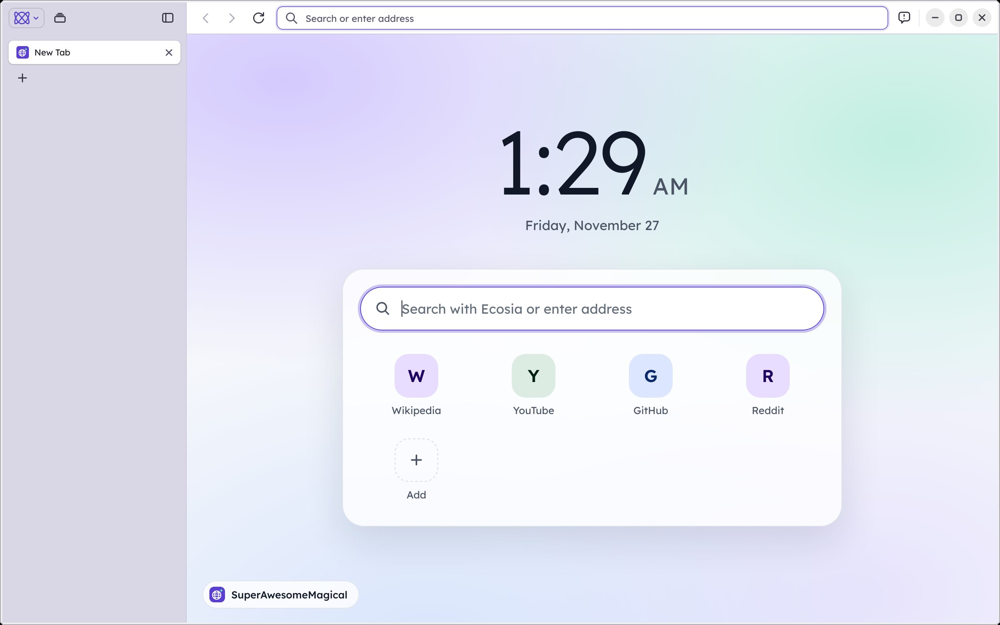
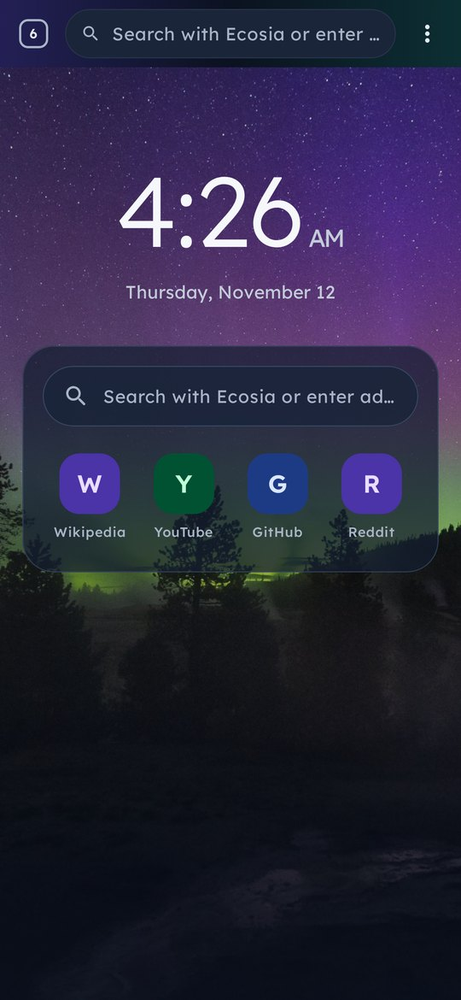
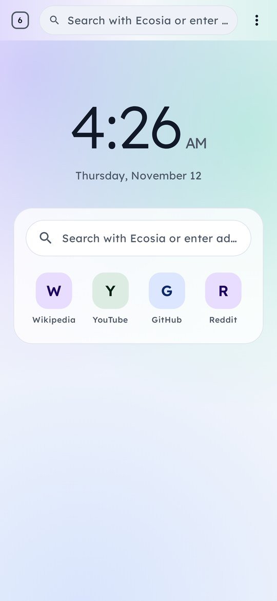
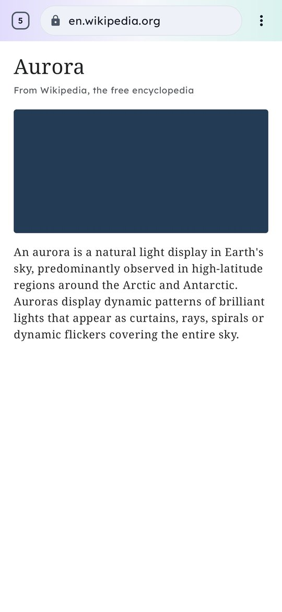

# SuperAwesomeMagical Browser

[Ladybird](https://ladybird.org), the independent web browser, set up the SuperAwesomeMagical
family's way: your tabs down the left side, Lexend everywhere, Ecosia for searches, a start page
like the SuperAwesomeMagicalLinux sign-in screen, and **Bitwarden built in**. For Linux (Fedora- and
Ubuntu-based), and an Android app in the same look.


- **Tabs down the left.** Ladybird's own vertical tabs, on from the start.
- **Lexend everywhere.** The interface, Ladybird's own pages, the start page, and web pages that
  don't choose a font. Lexend comes with the browser.
- **The family's colours.** Ladybird's Lavender colour theme, the nearest to the aurora's purple,
  light or dark with the system.
- **A start page like the sign-in screen.** A big Lexend clock, an Ecosia search box and your
  shortcuts over the northern lights (soft purple and green glows in light mode). *Add* puts a
  site there; hover one for × to take it off.
- **Bitwarden built in.** The key button beside the address field, or **Ctrl+Shift+L**, fills in
  your login for the site you're on; with several, you pick one. Sign in once with your email and
  master password (and two-step code) or an API key, on bitwarden.com, bitwarden.eu or your own
  server (Vaultwarden too); after that it only asks for your master password. Its verification
  code is copied for you as the login is filled in.
- **Ecosia** is the search engine (change it in Settings).
- **Quiet.** Ads and trackers blocked, Global Privacy Control on. Ladybird has no telemetry.
- **Kept up to date.** A new Ladybird release is built, checked and released here within hours.
- **Its own profile**, so it never mixes with a separately installed Ladybird.
- **Your bookmarks come along** from the Firefox-based versions on its first start.

| | |
|---|---|
|  |  |
|  | |

Ladybird is in alpha: some sites don't work yet, it crashes now and then, and its makers make no
promises about its security yet.

## Installing on Linux

Download the package for your system from the latest
[release](https://github.com/603Madison/SuperAwesomeMagicalBrowser/releases/latest). It has
everything in it: Ladybird, Bitwarden's client and the rest.

**Fedora** and others with dnf: `superawesomemagicalbrowser-<version>.x86_64.rpm`

```bash
sudo dnf install ./superawesomemagicalbrowser-*.x86_64.rpm
```

SuperAwesomeMagicalLinux has it already.

**Ubuntu** 24.04 and newer, Mint, Pop!_OS: `superawesomemagicalbrowser_<version>_amd64.deb`

```bash
sudo apt install ./superawesomemagicalbrowser_*_amd64.deb
```

To make it your default browser:

```bash
xdg-settings set default-web-browser io.github._603madison.SuperAwesomeMagicalBrowser.desktop
```

**Updates.** CI checks for a new Ladybird every six hours and builds, tests and publishes it on
its own, so install the newest package when one comes out (SuperAwesomeMagicalLinux does that
for you).

**Your data** lives in Ladybird's profile `superawesomemagical`
(`~/.config/Ladybird/Profiles/superawesomemagical`, and the matching folders in `~/.local/share`
and `~/.cache`); Bitwarden's sign-in is in `~/.local/share/superawesomemagicalbrowser/bitwarden`,
kept encrypted by Bitwarden's client. The Firefox-based versions' profile stays in
`~/.local/share/superawesomemagicalbrowser/profile`; its bookmarks are copied over once, and you
can delete it when you no longer need it.

## Android

Ladybird has no Android version yet, so the app for phones and tablets is on GeckoView (Firefox's
engine for Android), in the same look. Install `SuperAwesomeMagicalBrowser-<version>-android-arm64-v8a.apk`
from the newest `android-v…` [release](https://github.com/603Madison/SuperAwesomeMagicalBrowser/releases)
(the `x86_64` one is for the emulator and Chromebooks).

- **Tabs on the left**: the tabs button at the left of the address bar opens them as a drawer
  from the left; on a tablet they stay down the left side.
- The **start page** with the big clock, Ecosia search and your most visited sites (hold one to
  remove it), over the northern lights in dark mode.
- Lexend and the family's colours throughout, light or dark with the phone.
- **Private tabs**, Firefox's tracking protection with Total Cookie Protection, Global Privacy
  Control, downloads to the Downloads folder, and it can be the phone's default browser.

| | | | |
|---|---|---|---|
|  |  |  |  |

## How it's made

It is **Ladybird**, built from Ladybird's own release with one change of ours
(`desktop/ladybird/patches`): **Bitwarden in the toolbar**. The browser's interface talks to
Bitwarden's own command-line client (`bw`, which comes with the package): it signs in, keeps the
vault encrypted and matches logins to sites by Bitwarden's rules. The browser holds the key that
unlocks the vault only in memory, locks it 30 minutes after you last used it, and fills a login only
into a page still at the site it was looked up for. Everything else is beside Ladybird
(`desktop/edition`, installed in `/usr/share/superawesomemagicalbrowser`):

- `superawesomemagicalbrowser` (in `desktop/linux`): the launcher. It starts Ladybird in its own
  profile; on the first start it writes the presets there and brings the bookmarks over.
- `settings.json`: the presets, in Ladybird's own settings format: vertical tabs on the left, the
  Lavender colours, Ecosia, the start page for new tabs, content blocking, Global Privacy
  Control. Ladybird keeps them as yours from then on, all changeable in its Settings.
- `fonts.conf`: makes Lexend the default font (for the interface, and for pages that ask for
  `sans-serif`, `serif` or nothing), while fonts that pages name still come as they are.
- `start/`: the start page, an ordinary web page (its shortcuts live in its own storage).
- `firefox-bookmarks.py`: copies the Firefox-based versions' bookmarks into Ladybird's.

## Building

Ladybird takes hours to build, so CI does it (`.github/workflows/ladybird.yml`, running
`desktop/ladybird/build-ladybird.sh` in Fedora 44 and Ubuntu 24.04 containers) and keeps the
result. With those builds and Bitwarden's client in `desktop/out` (see the top of `build.sh`):

```bash
desktop/build.sh all
```

```bash
python3 desktop/check.py
```

`build.sh` puts the packages in `desktop/out`; `check.py` checks the installed package (it needs
Xvfb when there's no display), Bitwarden included. `desktop/release.env` holds our version,
the Ladybird release we build, the Bitwarden client's version, and Lexend's pin.

The Android app is a Gradle project in `android/` (Kotlin and Jetpack Compose on GeckoView), with
its version and GeckoView's in `android/release.env`:

```bash
cd android && ./gradlew testDebugUnitTest assembleRelease
```

`tools/icons.py` draws the icon. CI (`.github/workflows/linux.yml`) builds every change, installs
the packages on Ubuntu 24.04 and 26.04 and Fedora 44 and 45 and checks them there, follows
Ladybird's releases and publishes ours; `.github/workflows/android.yml` tests the app, follows GeckoView and
publishes the signed APKs.

## Licence

GPL-3.0, like the rest of the family, for our files. Ladybird is the Ladybird Browser
Initiative's, under the BSD 2-Clause licence; this is not a Ladybird product. Bitwarden's
command-line client is Bitwarden's, under the GPL-3.0; this is not a Bitwarden product either.
Lexend is under the SIL Open Font Licence. The start page photo, *Aurora borealis, Upper Geyser Basin* by NPS / Neal
Herbert, is in the public domain (see `desktop/edition/start/CREDITS.md`).
